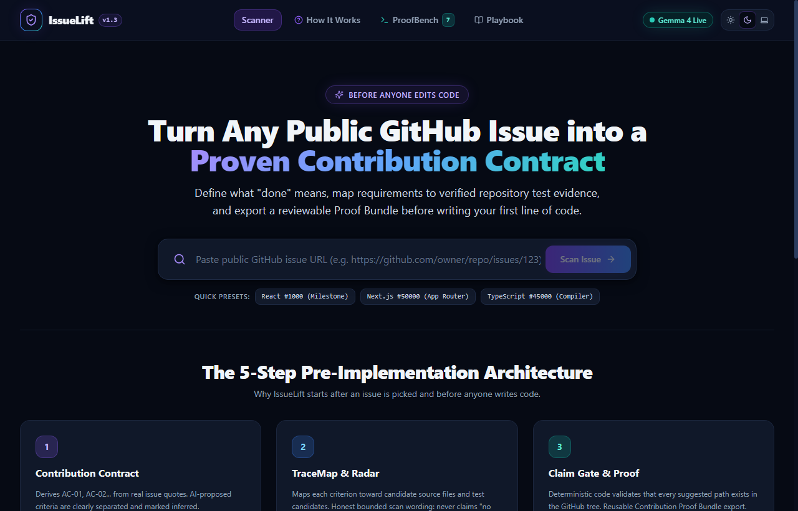
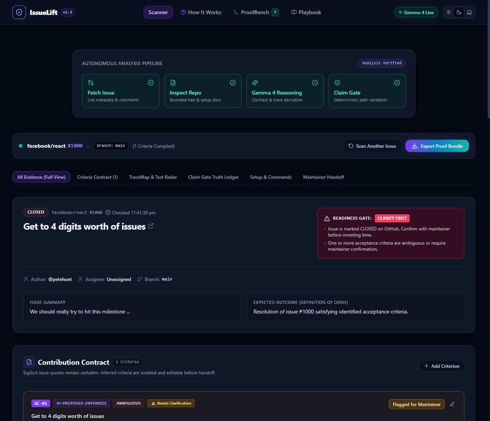
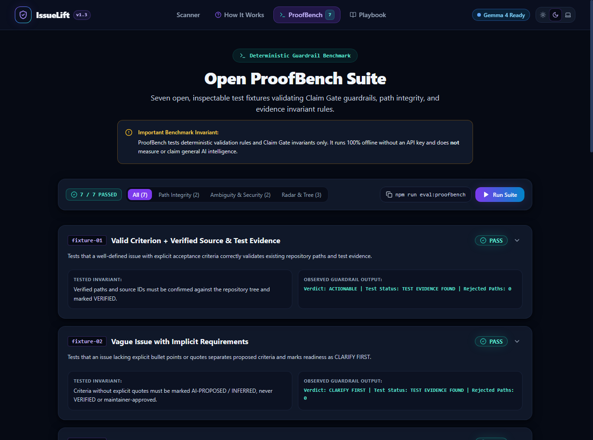

# IssueLift v1.3

**Turn a public GitHub issue into a clear, evidence-backed next step before coding begins.**

IssueLift helps open-source contributors understand what “done” means before they change code. It builds a Contribution Contract from an issue, maps requirements to candidate source and test evidence, checks claims with a deterministic Claim Gate, and exports a Proof Bundle.

**Live app:** https://issue-lift.vercel.app/
**Source code:** https://github.com/rudraarcadeskills-art/IssueLift-HackDay-2026

Built with Next.js, TypeScript, Tailwind CSS, Google Gemma 4, and a deterministic Claim Gate.

## The problem

New contributors can spend hours implementing an issue only to discover that the requirements were ambiguous, an expected test pattern was missed, or the maintainer understood “done” differently. IssueLift helps clarify the work before implementation starts.

## How it works

1. **Submit an issue.** Paste a public GitHub issue URL.
2. **Scan bounded context.** IssueLift reads issue metadata and selected repository files, manifests, and documentation within GitHub API limits.
3. **Draft a Contribution Contract.** Explicit issue requirements remain linked to their source. AI-proposed criteria are clearly labelled as inferred—not maintainer-approved.
4. **Build an evidence TraceMap.** Criteria are mapped to candidate source files, candidate test files, and documented test commands where evidence is available.
5. **Verify and export.** The deterministic Claim Gate checks file paths against the fetched repository tree and records unsupported claims. IssueLift exports a Markdown or JSON Proof Bundle and a copy-ready maintainer question.

Gemma 4 helps interpret issue text. Deterministic checks validate important claims. Contributors remain in control: IssueLift does not auto-post comments or execute repository code.

## Product screenshots

### 1. Issue intake



Paste a public issue URL and begin a bounded scan.

### 2. Contribution Contract and TraceMap



Review acceptance criteria and candidate evidence, including the distinction between verified file existence and inferred relevance.

### 3. ProofBench



The offline ProofBench checks deterministic guardrails using labelled fixtures.

## Core features

- **Contribution Contract Compiler:** separates explicit issue excerpts from AI-proposed criteria.
- **Acceptance-to-Test TraceMap:** connects criteria to candidate implementation and test evidence, plus documented commands when available.
- **Test Gap Radar:** explains when bounded scans do not establish relevant test evidence and suggests a manual verification path.
- **Claim Gate and Truth Ledger:** checks candidate paths against the fetched repository tree and rejects or demotes unsupported claims.
- **Maintainer Handoff:** drafts a focused question for the contributor to review and copy manually.
- **Proof Bundle:** exports the current analysis as Markdown or JSON.
- **ProofBench:** runs seven deterministic fixtures without requiring a Gemma API key.

## Honest limits

Repository scans are bounded by API and context limits. A file path existing does not prove that the file is relevant to a particular requirement. Test relevance may remain inferred or unconfirmed, and a truncated scan is reported as incomplete. IssueLift does not claim that no tests exist simply because a bounded scan did not find a relevant test. It also does not execute third-party repository code.

## Open innovation

IssueLift makes its reliability rules inspectable. Contributors can review the Claim Gate and add regression fixtures under `eval/fixtures/` when they find a case where a path, citation, criterion, or test-evidence label is wrong. These guardrails can be improved through code review and counterexamples without retraining model weights.

## Tech stack and architecture

- Next.js and React
- TypeScript and Tailwind CSS
- Google Gemma 4 through the server-side `@google/genai` SDK
- Zod validation and deterministic Claim Gate checks
- GitHub REST API for public issue and repository context

Gemma requests run server-side. `GEMMA_API_KEY` must never be exposed through a `NEXT_PUBLIC_` environment variable or committed to Git. If Gemma is unavailable or not configured, the deterministic baseline compiler can provide fallback analysis.

See [`docs/architecture.md`](docs/architecture.md) for architecture and security details.

## Quick start

### Requirements

- Node.js 18.18+ (or a compatible supported Node.js 20+ release)
- npm
- Git

### Install and run

```bash
git clone https://github.com/rudraarcadeskills-art/IssueLift-HackDay-2026.git
cd IssueLift
npm install
cp .env.local.example .env.local
npm run dev
```

Open `http://localhost:3000`.

The app can use its deterministic baseline without a Gemma key. To enable Gemma analysis, add the following to the local `.env.local` file and restart the development server:

```dotenv
GEMMA_API_KEY=your_api_key_here
GEMMA_MODEL=gemma-4-26b-a4b-it
# Optional: GITHUB_TOKEN=your_token_for_higher_GitHub_API_limits
```

Keep `.env.local` local and private. Never commit API keys.

## Verification

The following results were recorded in the project’s latest reported local verification run; rerun the commands after making changes to confirm the current state.

| Command | Reported result | Purpose |
|---|---:|---|
| `npm test` | 80 tests passed across 4 suites | Unit and regression tests |
| `npm run eval:proofbench` | 7/7 fixtures passed | Offline deterministic guardrail evaluation |
| `npm run typecheck` | Passed, 0 TypeScript errors | Type checking |
| `npm run build` | Passed | Production build |

ProofBench is separate from the Vitest unit-test suite and runs without an API key.

## Project resources

- [Live app](https://issue-lift.vercel.app/)
- [Demo script](docs/demo-script.md)
- [Architecture and threat model](docs/architecture.md)
- [QA report](docs/qa-report.md)
- [ProofBench evaluation report](docs/eval-report.md)
- [Contributing guide](CONTRIBUTING.md)
- [License](LICENSE)

**Presentation deck:** `submission/IssueLift_Submission.pptx` (8 slides). The deck is also intended to be uploaded separately wherever the event submission form requests a presentation attachment.

## License

The project source code is released under the MIT License. Google Gemma model weights and API usage remain subject to Google’s Gemma Terms of Use.

## AI Development Tools Disclosure

IssueLift was developed with assistance from AI tools.

- **Antigravity:** AI coding agent used for implementation and development.
- **ChatGPT:** Used for project planning, prompt preparation, debugging guidance, and code review.
- **Google Gemma 4:** Integrated into the application for issue analysis and Contribution Contract generation.

All final project changes were tested and reviewed before submission.