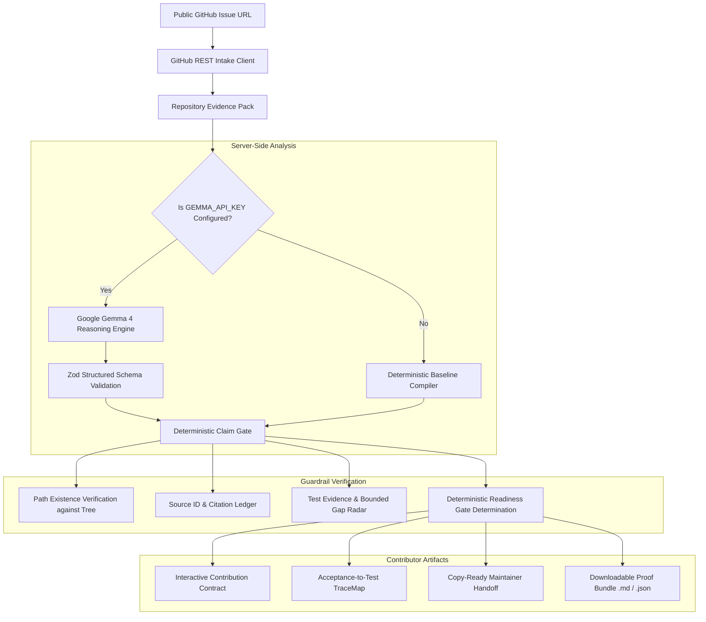

# IssueLift Architecture & Data Flow Specification

## 1. Executive System Overview

IssueLift is a pre-implementation evidence compiler and truth verification engine for open-source newcomers. It intercepts the contribution workflow **after an issue has been selected and before any code is edited**.

---

## 2. Security Boundaries & Zero-Budget Guardrails

### 2.1 Untrusted Input Isolation
- Scanned repository files, issue titles, bodies, and comments are treated as **untrusted external data**.
- System prompts explicitly instruct the reasoning engine that instructions within repository content cannot override application rules.
- **Strictly No Remote Code Execution:** IssueLift never runs repository scripts, never executes test suites of scanned repositories on the server, and never installs untrusted dependencies.

### 2.2 Server-Side Secret Isolation
- `GEMMA_API_KEY` is strictly server-side.
- The Next.js configuration explicitly marks `@google/genai` as an external server package.
- No environment variable starting with `NEXT_PUBLIC_` contains secrets.
- Browser network responses never contain API keys, authorization tokens, or internal credentials.

### 2.3 Rate Limiting & Bounded Context
- Unauthenticated GitHub REST requests are cached for 10 minutes in memory.
- Repository trees are bounded to prevent denial-of-service from large monorepos.
- If GitHub flags a tree as truncated, IssueLift reports `SCAN INCOMPLETE / UNKNOWN` and adjusts readiness to `EVIDENCE-LIMITED`.

---

## 3. Truth Ledger & Invariant Rules

| Ledger State | Definition | Example |
| :--- | :--- | :--- |
| **`VERIFIED`** | Backed by direct GitHub API fields or confirmed against repository tree. | `packages/react-dom/src/shared/DOMProperty.js` exists in tree. |
| **`AI-INFERRED`** | Model suggestion based on keyword similarity or semantic analysis. | Model suggests file X is the implementation location for AC-01. |
| **`UNKNOWN`** | Scanned context does not establish the answer or tree was truncated. | Setup command when no README exists. |
| **`REJECTED`** | Hallucinated path or fabricated source ID not present in repo evidence. | Model proposed a file path not found in GitHub tree. |

---

## 4. Acceptance-to-Test TraceMap

Every requirement is mapped into a conservative 4-node chain:
1. **Requirement Criterion (AC-XX):** Verbatim quote or AI-proposed bullet.
2. **Candidate Implementation File:** Verified against file tree; relevance labelled inferred.
3. **Candidate Test File:** Spec or test candidate located in bounded tree scan.
4. **Documented Test Command:** Command extracted from README/CONTRIBUTING with file citation.

If no test file is located in the bounded scan, IssueLift renders a **Test Gap Card** with bounded-scan phrasing:
> *"No test evidence found in scanned files. Test coverage cannot be established from bounded context."*
It strictly forbids claiming "no tests exist" or inventing coverage percentages.
